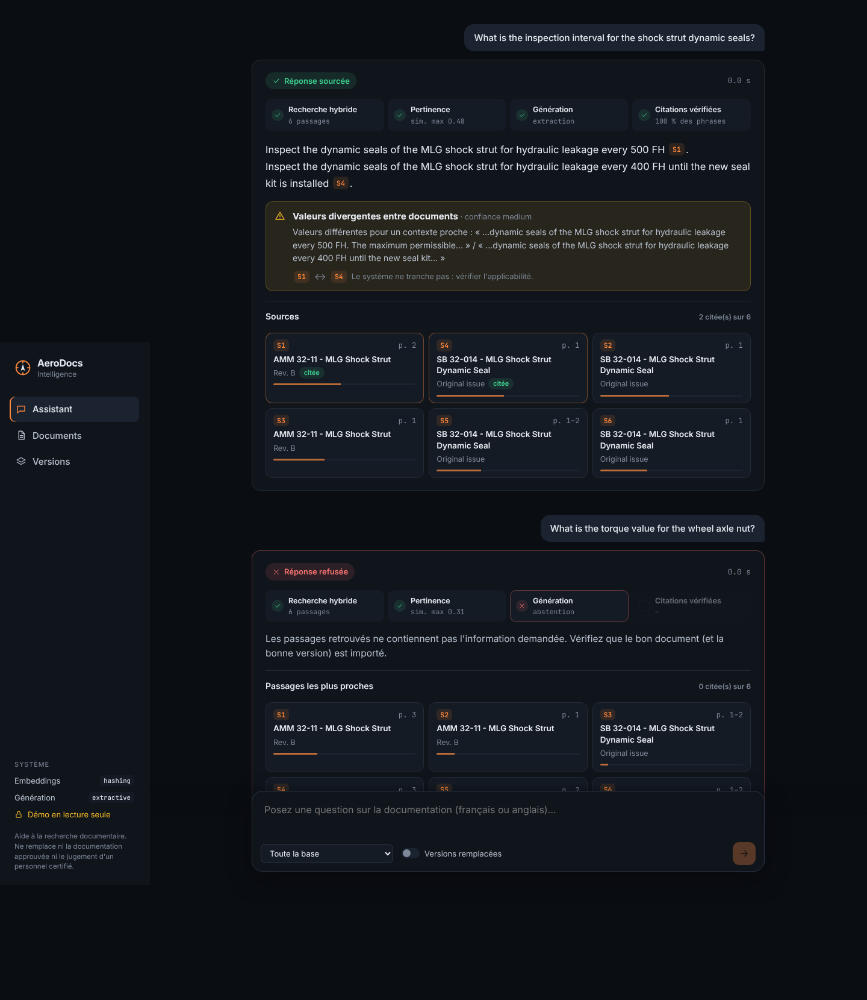
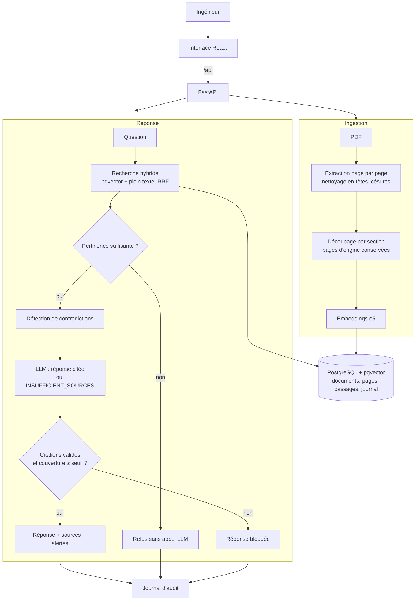

# AeroDocs Intelligence

**Assistant IA pour la documentation technique aéronautique : chaque réponse cite le document, la version et la page sources, et le système refuse de répondre quand les sources ne suffisent pas.**

Projet 02 du portfolio de Steven Jansen. Il fait suite à AeroHealth AI (maintenance prédictive).

**[Démo en ligne](https://huggingface.co/spaces/Steevv/aerodocs-intelligence)** (lecture seule, corpus fictif, réponses extractives sans LLM) · [Évaluation](docs/EVALUATION.md) · [Architecture](docs/ARCHITECTURE.md)



## Le problème

Un ingénieur maintenance ou navigabilité doit croiser des milliers de pages : AMM, bulletins de service, consignes de navigabilité, règlements EASA. Ces documents sont révisés en permanence et se contredisent parfois : un bulletin de service peut réduire un intervalle fixé par le manuel. Un assistant IA n'est utile dans ce contexte que s'il respecte trois conditions :

1. **Chaque affirmation est traçable** jusqu'à un document, une version et une page.
2. **Il se tait quand il ne sait pas.** Une réponse inventée sur un couple de serrage ou un intervalle d'inspection est pire que pas de réponse.
3. **Il signale les divergences entre sources** au lieu de les lisser, et ne mélange pas une révision remplacée avec la version en vigueur.

AeroDocs est construit autour de ces trois contraintes. La génération de texte n'est qu'un maillon parmi d'autres.

## Fonctionnalités

| Fonctionnalité | Mise en œuvre |
|---|---|
| Import de PDF techniques | Upload via l'API ou l'interface, dédoublonnage SHA-256, rejet explicite des PDF scannés (pas d'OCR) |
| Extraction et indexation | Texte page par page, suppression des en-têtes et pieds de page répétés, recollage des césures, découpage qui respecte les sections (M.A.301, CS 25.571, 2.1…) |
| Recherche sémantique | Embeddings `multilingual-e5-small` dans **pgvector** (index HNSW). Une question en français trouve une documentation en anglais |
| Recherche hybride | Fusion par rangs (RRF) avec le plein texte PostgreSQL, pour retrouver les identifiants exacts (`SB-32-014`, `P/N 32-1175-02`) que les embeddings ratent |
| RAG avec citations | Contexte numéroté [S1]…[Sn]. Chaque phrase de la réponse doit être citée, avec un lien direct vers la page du PDF |
| Vérification des citations | Après génération : les citations inexistantes sont retirées et la part de phrases citées est mesurée. En dessous du seuil, la réponse est **bloquée** |
| Refus | Trois niveaux : seuil de pertinence avant tout appel au LLM, abstention du LLM sur consigne, blocage après vérification |
| Contradictions | Heuristique sur les valeurs chiffrées (même unité, contexte proche, documents différents), confirmée par un juge LLM s'il y en a un de configuré |
| Versions | Familles documentaires, version en vigueur déterminée par la date d'effet, révisions remplacées exclues par défaut, diff section par section |
| Traçabilité | Chaque question est journalisée (décision, motif de refus, passages cités, latence) : `GET /api/queries` |
| LLM interchangeable | `extractive` (aucun LLM, par défaut), Anthropic, OpenAI ou API compatible (Mistral…), **Ollama en local** (aucune donnée ne sort) |

## Démarrage

```bash
cp .env.example .env
docker compose up -d --build                                          # PostgreSQL/pgvector + API + interface
docker compose exec api python -m scripts.seed_demo /data/corpus/demo  # corpus de démonstration
```

Sous Linux/macOS, `make up` et `make demo` font la même chose. PostgreSQL est exposé sur le port 5433 de la machine, pour ne pas entrer en conflit avec une instance locale.

- Interface : http://localhost:8080
- API (OpenAPI) : http://localhost:8000/docs

Par défaut, aucune clé API n'est nécessaire : le mode `extractive` répond avec les phrases sources les plus pertinentes, citées telles quelles. Pour une vraie génération, renseignez `LLM_PROVIDER` et `LLM_MODEL` dans `.env` (voir les exemples dans le fichier), puis lancez `docker compose up -d api`.

### LLM local (Ollama + Mistral 7B)

```bash
# dans .env : LLM_PROVIDER=ollama, LLM_MODEL=mistral
docker compose --profile ollama up -d
docker compose exec ollama ollama pull mistral
```

Le service Ollama réserve le GPU NVIDIA (Docker Desktop + WSL2). Sur une RTX 2060 (6 Go), Mistral 7B quantifié tient en mémoire. Sans GPU, supprimez le bloc `deploy` du service `ollama` dans `docker-compose.yml` : la génération passe sur CPU, et compte alors plusieurs minutes par réponse.

### Déploiement de la démo (Hugging Face Spaces)

L'image `deploy/Dockerfile.space` regroupe PostgreSQL + pgvector, l'API et l'interface dans un seul conteneur, sur le port 7860. Elle tourne en lecture seule et importe le corpus fictif au démarrage. Le workflow `.github/workflows/deploy-space.yml` la publie à chaque push sur `main`. Il nécessite, dans les paramètres du dépôt GitHub (Secrets and variables, puis Actions) :

- le secret `HF_TOKEN`, un token Hugging Face avec droit d'écriture ;
- la variable `HF_SPACE`, par exemple `Steevv/aerodocs-intelligence`.

Pour activer une vraie génération sur la démo, ajoutez `LLM_PROVIDER`, `LLM_MODEL` et `ANTHROPIC_API_KEY` dans les secrets du Space.

### Données réelles (EASA)

Voir [docs/DATA.md](docs/DATA.md). Les Easy Access Rules for Continuing Airworthiness existent en plusieurs révisions publiques, ce qui permet de tester la gestion des versions sur de vrais documents de plus de 1 000 pages :

```bash
python backend/scripts/import_folder.py data/raw --api http://localhost:8000
```

## Architecture



Le détail des choix techniques est dans [docs/ARCHITECTURE.md](docs/ARCHITECTURE.md).

## Évaluation

`make eval` lance 20 questions annotées : 13 qui ont une réponse dans le corpus (dont une en français) et 7 qui n'en ont pas (dont une question piège). Le script mesure séparément la récupération (hit@k, MRR), l'exactitude des réponses, la justesse des citations, le refus (précision et rappel) et la détection de contradictions.

Résultats avec `multilingual-e5-small`, sans LLM : le bon passage est retrouvé en premier pour les 13 questions (MRR 1.00), 12 réponses justes sur 13, 7 refus corrects sur 7, aucune citation fausse. Le seul échec est la question en français : la recherche trouve le bon passage, mais le mode sans LLM ne sait pas relier les mots français au texte anglais. L'évaluation montre aussi que la similarité seule ne permet pas de décider d'un refus : la question piège obtient un score plus élevé qu'une question légitime. C'est pour cela que le refus se fait en trois étapes. Les limites de cette mesure sont détaillées dans [docs/EVALUATION.md](docs/EVALUATION.md).

## Tests

```bash
docker compose up -d db
make test
```

25 tests, exécutés sur un vrai PostgreSQL avec pgvector (pas de SQLite) : découpage, nettoyage, citations, refus, contradictions, diff de versions et garde-fous face à un LLM simulé qui invente des citations. La CI GitHub Actions lance les tests et le build du front.

## Limites connues

- **Pas d'OCR** : les PDF scannés sont refusés avec un message explicite.
- **Tableaux** : l'extraction texte de pypdf aplatit les tableaux. Une valeur lue dans un tableau complexe peut perdre sa ligne ou sa colonne.
- **Effectivité** : le système ne sait pas si un bulletin de service s'applique à un numéro de série donné (MSN) ni s'il a déjà été appliqué. Une contradiction est un signal à vérifier, pas une conclusion.
- **Seuils de refus** : ils sont calibrés sur un petit corpus. Il faut les recalibrer sur des données réelles avant tout usage sérieux.
- **Ingestion synchrone** : un document de 1 000 pages bloque la requête pendant plusieurs minutes. La prochaine étape serait une file de tâches (Celery ou RQ).
- Ce n'est pas un outil certifié : il aide à chercher dans la documentation approuvée, il ne la remplace pas.

## Stack

Python 3.12 · FastAPI · SQLAlchemy 2 · PostgreSQL 16 + pgvector (HNSW) · sentence-transformers · pypdf · React 18 + TypeScript + Vite · Docker Compose · GitHub Actions

## Arborescence

```
backend/
  app/
    ingestion/    extraction PDF, découpage, pipeline d'import
    retrieval/    embeddings, recherche hybride
    generation/   prompts, clients LLM, mode extractif, vérification des citations, orchestration RAG
    analysis/     contradictions, diff de versions
    api/          routes FastAPI
  scripts/        corpus démo, import EASA, évaluation
  eval/           questions annotées
  tests/
frontend/         interface React
data/demo/        corpus de démonstration (fictif)
docs/             architecture, évaluation, données, captures
```
