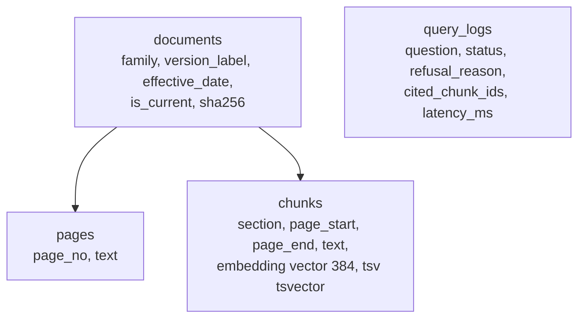

# Architecture et choix techniques

## Pourquoi pas LangChain ni LlamaIndex

Le pipeline est écrit à la main (environ 1 500 lignes de Python, commentaires compris). Ces frameworks accélèrent un prototype, mais ils cachent exactement ce qu'un projet sur la fiabilité doit montrer : comment le contexte est construit, à quel moment le système refuse, et comment les citations sont vérifiées. Ici, chaque garde-fou est une fonction testée et isolée. Brancher LlamaIndex pour l'ingestion resterait possible : le reste du code ne dépend que de la table `chunks`.

## Modèle de données

- **Une ligne `documents` correspond à une version.** Les versions d'un même document partagent `family`. La version en vigueur (`is_current`) est recalculée à chaque import ou suppression : date d'effet la plus récente, puis ordre d'import en cas d'égalité.
- **`pages`** conserve le texte nettoyé de chaque page. Elle sert à afficher les sources et à comparer les versions sans repasser par le PDF.
- **`chunks.tsv`** est une colonne générée par PostgreSQL (index GIN). L'application n'a donc pas à la maintenir.
- **`chunks.embedding`** a un index HNSW (`vector_cosine_ops`). Au démarrage, l'API vérifie que la dimension de la colonne correspond au modèle configuré : changer de modèle sans réindexer fait échouer le démarrage avec un message clair, au lieu de donner des résultats faux sans prévenir.

## Ingestion

1. **Extraction page par page** (pypdf). La page physique est la référence de citation, parce que c'est celle qu'ouvre le lien `#page=N` dans le navigateur.
2. **Nettoyage.** Les lignes courtes répétées en haut ou en bas d'au moins 60 % des pages (et d'au moins 3 pages) sont supprimées. Exemple : « Powered by EASA eRules Page 12 of 1265 », où les chiffres sont normalisés avant comparaison. Les césures en fin de ligne sont recollées.
3. **Découpage guidé par la structure.** Un titre de section détecté force un nouveau passage, sans chevauchement d'une section à l'autre. Les motifs reconnus : références EASA `M.A.301`, `145.A.30`, `CAMO.A.315`, `CS 25.571`, `AMC1 …`, numérotation `2.1 …`, titres en capitales. Ainsi, une citation pointe toujours vers une section cohérente. À l'intérieur d'une section : environ 1 000 caractères, avec 150 de chevauchement.
4. **Embeddings contextualisés.** Le texte encodé est `titre | section \n passage`. Un passage isolé comme « The interval is 500 FH » reste rattaché à son composant.

## Recherche

Recherche hybride avec fusion par rangs (RRF, k = 60) :

- **vectorielle** (pgvector) : elle comprend les reformulations, et le multilingue avec e5 ;
- **plein texte** PostgreSQL : la requête est convertie en OU (`plainto_tsquery` avec `&` remplacé par `|`) pour une question en langage naturel. Elle retrouve les identifiants exacts.

On fusionne les rangs plutôt que les scores, parce qu'une similarité cosinus et un `ts_rank_cd` ne sont pas comparables. Les filtres (version en vigueur seulement, famille, documents précis) sont appliqués dans le SQL, avant le classement.

## Garde-fous

| Étape | Contrôle | Coût |
|---|---|---|
| Avant génération | Similarité du meilleur passage < `MIN_SIMILARITY` : refus | aucun appel LLM |
| Génération | Consigne : répondre `INSUFFICIENT_SOURCES` si les sources ne suffisent pas | 1 appel |
| Après génération | Citations hors contexte retirées ; aucune citation valide, ou moins de 60 % de phrases citées : réponse bloquée | aucun |

Le seuil de similarité dépend du modèle d'embeddings : e5 donne des cosinus élevés (environ 0,8), le hachage lexical des cosinus bas (environ 0,1 à 0,5). Il se recalibre avec `scripts/evaluate.py`, qui affiche la similarité maximale de chaque question.

## Contradictions

1. On ne compare que des paires de passages issus de **documents différents et en vigueur**. Deux révisions d'un même document ne se contredisent pas : on parle d'**évolution entre versions**, signalée à part.
2. Heuristique : on extrait les quantités (FH, FC, mois, psi, N.m, mm…). Si deux passages donnent des valeurs différentes dans la même unité, avec un contexte lexical proche (Jaccard ≥ 0,25 sur les mots qui précèdent la valeur), la paire est signalée.
3. Si un LLM est configuré, il sert d'arbitre sur les paires candidates (au plus 3 appels). Sans LLM, l'heuristique est utilisée seule, avec un niveau de confiance associé.

Le système ne dit pas quelle source a raison. Un bulletin de service plus restrictif peut parfaitement primer sur le manuel : c'est à l'ingénieur de le décider.

## Comparaison de versions

`GET /api/versions/diff?from_id=&to_id=` découpe chaque version en sections, avec le même détecteur de titres que l'ingestion, puis les aligne par titre et compare phrase par phrase. Comparer phrase par phrase rend le diff insensible aux changements de mise en page d'une révision à l'autre.
